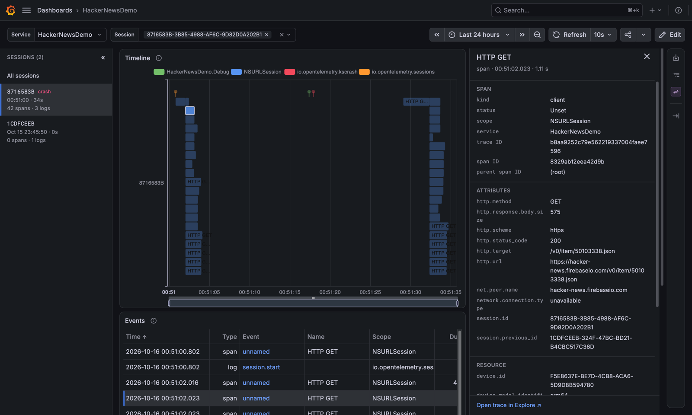

# Grafana Dashboard

A local Grafana view for the telemetry sent by [`HackerNewsDemo`](../HackerNewsDemo): an OpenTelemetry Collector on `localhost:4317`/`4318` forwarding to [`grafana/otel-lgtm`](https://github.com/grafana/docker-otel-lgtm) (Grafana, Tempo, Loki, Prometheus) on http://localhost:3000.



## Usage

Needs Docker with Compose v2, and the app running in the iOS simulator (a physical device can't reach `localhost`). From the repo root:

```sh
Examples/GrafanaDashboard/run.sh          # start and open Grafana
Examples/GrafanaDashboard/run.sh down     # stop (telemetry is kept)
Examples/GrafanaDashboard/run.sh reset    # stop and delete the stored telemetry
```

Or `make`, `make down`, `make reset` from this directory. Then run the app and open http://localhost:3000/d/hackernews-demo. **Settings → Custom Span / Log** in the app sends test data on demand.

The first start (and the first after a reset) downloads Grafana plugins, which takes a few minutes; the Timeline shows an error until then.

Grafana has no login and the ports listen on localhost only. Telemetry is kept in the `lgtm-data` volume.

## Editing the Timeline

The Timeline panel is drawn by [`grafana/timeline.js`](grafana/timeline.js), which the [Business Charts](https://grafana.com/grafana/plugins/volkovlabs-echarts-panel/) plugin imports from Grafana at `/public/hackernews-demo/timeline.js`. Edit it and refresh the dashboard; no restart needed. Grafana only reads `grafana/hackernews-demo.json` at startup, so after editing that, run `docker compose restart lgtm` from this directory.
