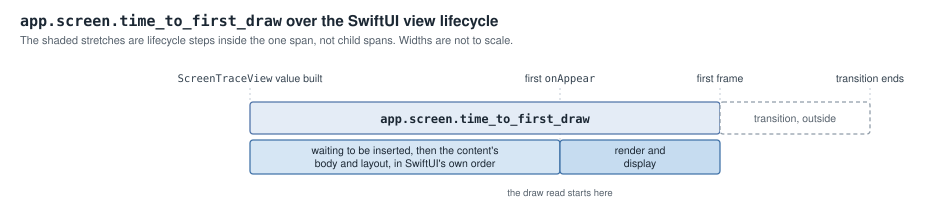

# SwiftUI Screens

Status: experimental. Shared names and processors: [Screen README](../README.md).

The **`ScreenInstrumentationSwiftUI`** module reports SwiftUI views marked as screens. `otelScreen(_:attributes:)` wraps a view in a `ScreenTraceView`. Each `onAppear` sets the current screen. Each view identity records one `app.screen.time_to_first_draw` span, from when the view was built to the first frame displayed after its first `onAppear`. It swizzles nothing.

On macOS and watchOS, which have no display link, the span ends at `onAppear` instead.



Register the [processors](../docs/setup.md), then mark each screen:

```swift
import ScreenInstrumentationSwiftUI

SettingsView()
  .otelScreen("Settings")
```

## Instance properties

### `app.screen.time_to_first_draw`

<dl>
<dt>Scope</dt>
<dd><code>io.opentelemetry.screen.swiftui</code></dd>
<dt>Start time</dt>
<dd>When the parent's <code>body</code> built the <code>ScreenTraceView</code> that SwiftUI kept.</dd>
<dt>End time</dt>
<dd>The first frame displayed after the first <code>onAppear</code>, read from the display link. On macOS and watchOS, the first <code>onAppear</code>.</dd>
<dt>Attributes</dt>
<dd><code>app.screen.name</code>; <code>app.screen.type</code> = <code>swiftui</code>; the modifier's <code>attributes</code>.</dd>
</dl>

SwiftUI has no public callback between building a view and `onAppear`, so the span cannot be divided there, and those rows follow no documented order.

| Lifecycle step                           | In span | Time spent on                                 | Source                                                                                       |
| ---------------------------------------- | :-----: | --------------------------------------------- | -------------------------------------------------------------------------------------------- |
| Parent's `body` builds `ScreenTraceView` | Start   | Creating the `@State` that holds the start    | [`State`][state]: "always instantiates its default value when SwiftUI instantiates the view" |
| Insertion into the view graph            | ✓       | Waiting to be shown                           | Not documented                                                                               |
| Content `body`                           | ✓       | Evaluating the screen's views                 | Not documented                                                                               |
| Layout                                   | ✓       | Sizing and placing views                      | Not documented                                                                               |
| `onAppear`                               | ✓       | Sets the current screen; the draw read starts | [`onAppear(perform:)`][onAppear]: "completes before the first rendered frame appears"        |
| First frame                              | End     | Rendering and displaying the view             | [`onAppear(perform:)`][onAppear]: as above; read from the display link                       |
| Transition animation                     | —       | Push or presentation animation                | Not documented                                                                               |

<dl>
<dt>Early start</dt>
<dd><code>@State</code> creates its default value each time the view value is built, and SwiftUI keeps the state of the value it inserts. <a href="https://developer.apple.com/documentation/swiftui/navigationlink/init(destination:label:)-27n7s"><code>NavigationLink(destination:label:)</code></a> takes a non-escaping <code>destination</code> closure, which must run inside the initializer, so the destination is built on every parent update and the span starts at the last one before the tap. <a href="https://developer.apple.com/documentation/swiftui/view/navigationdestination(for:destination:)"><code>navigationDestination(for:destination:)</code></a> builds the destination when the stack presents it.</dd>
<dt>First frame</dt>
<dd>Apple guarantees that <code>onAppear</code> completes before the first rendered frame, though the exact moment "depends on the specific view type". A <code>CADisplayLink</code> started in <code>onAppear</code> ignores its first refresh, when that frame renders, and ends the span at the second, when it is displayed.</dd>
<dt>Background</dt>
<dd>Entering the background before the first frame cancels the read; the view's next appearance measures again, from the same load time.</dd>
</dl>

[state]: https://developer.apple.com/documentation/swiftui/state
[onAppear]: https://developer.apple.com/documentation/swiftui/view/onappear(perform:)

A returning screen sets the current screen but records no span. A recreated view, after an identity change or lazy-container recycling, records a new one.

## Instance methods

<dl>
<dt><code>View.otelScreen(_:attributes:)</code></dt>
<dd>Reports the view as a screen with the given name and attributes. Use a stable name. Apply it to screens, not rows: any appearance sets the current screen.</dd>
<dt><code>ScreenTraceView(_:attributes:content:)</code></dt>
<dd>The same, as a wrapper view.</dd>
</dl>

## Specifications

| Name                            | Kind      | Specification                                                                                 |
| ------------------------------- | --------- | --------------------------------------------------------------------------------------------- |
| `app.screen.type` = `swiftui`   | Attribute | [`screen.yaml`](../../SemanticConventions/model/swift/screen.yaml)                            |
| `app.screen.time_to_first_draw` | Span      | [`screen-spans.yaml`](../../SemanticConventions/model/swift/screen-spans.yaml), `swiftui` row |
| `app.navigation.complete`       | Event     | [`screen.yaml`](../../SemanticConventions/model/swift/screen.yaml)                            |

## Compatibility

| Platform       | Minimum | Records            | Tested on                    |
| -------------- | ------- | ------------------ | ---------------------------- |
| iOS            | 15      | Every marked view  | Simulator, integration tests |
| iPadOS         | 15      | As iOS             | —                            |
| Mac Catalyst   | —       | As iOS             | —                            |
| tvOS           | 15      | As iOS             | —                            |
| visionOS       | 1       | As iOS             | —                            |
| macOS          | 12      | Ends at `onAppear` | Unit tests only              |
| watchOS        | 8       | Ends at `onAppear` | —                            |
| Linux, Windows | —       | Nothing; no API    | —                            |

Untested rows describe the code, not observed telemetry. On Linux and Windows, guard `otelScreen` calls with `canImport(SwiftUI)`.

## See also

- [Screen Instrumentation](../README.md)
- [UIKit screens](../UIKit/README.md): `tracksHostingControllers` for mixed apps
- [Limits and testing](../docs/limits.md)
- [`onAppear(perform:)`](https://developer.apple.com/documentation/swiftui/view/onappear(perform:))
- [`State`](https://developer.apple.com/documentation/swiftui/state)
